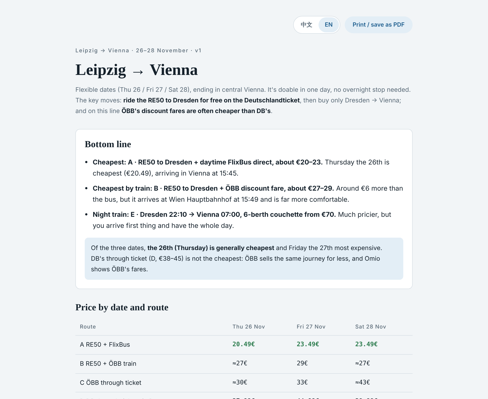
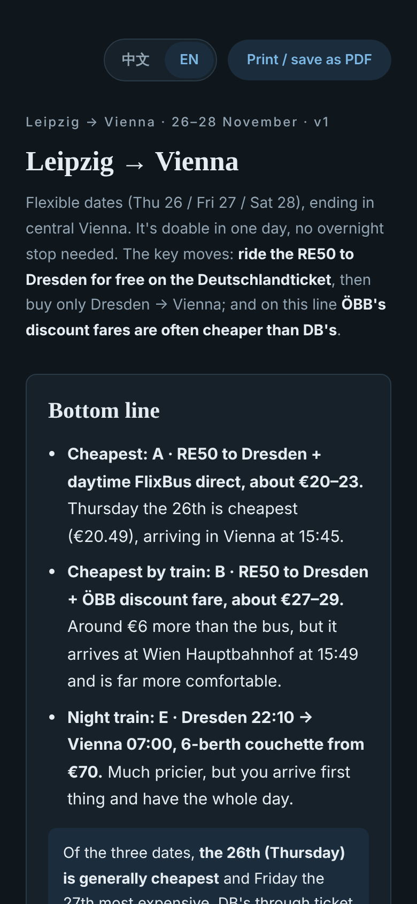

# Europe Route Finder

**English** · [中文](README.zh-CN.md)

**An AI-agent skill that finds European train, bus and night-train routes like a seasoned budget traveller.** Booking sites only search "A → B". This skill expands both ends into a ring of hub cities. That turns up the direct trains, night trains and regional buses that comparison sites miss. It then compares real fares on operator sites against aggregators, adds the hostel for any overnight stop to the total, and tells you where to buy each leg most cheaply. The result is one bilingual (中文 / English) comparison page you can open or share.

It works with any AI agent that can browse the web: Claude, Claude Code, Cursor, Codex, ChatGPT, Gemini.

<p>
  
  
</p>

**Live example:** [Leipzig → Vienna](https://htmlpreview.github.io/?https://github.com/JialiNong/europe-route-finder-skill/blob/main/europe-route-finder/examples/leipzig-vienna.html) (the toggle at the top right switches between 中文 and English) · source data: [`leipzig-vienna.json`](europe-route-finder/examples/leipzig-vienna.json)

---

## Why

Google Maps, Omio and Interrail plan between the origin and the destination station only, so they routinely miss better options:

- **Leipzig → Les Arcs (French Alps ski resort):** the instinct is to change in Geneva, but Geneva beds, Swiss trains and the Geneva–resort shuttle are all expensive. Better: on day 1, DB to Bern (about €41) and a hostel night (about €33). On day 2, a FlixBus that **skips Geneva** to Annecy, regional bus Y51 to Albertville, then a TER train to the valley station, where the train ticket gets you a free lift up. About €105–110 in total, arriving by noon, with backups on every leg.
- **Leipzig → Vienna:** ride regional trains free to Dresden on the Deutschlandticket, then take a daytime FlixBus direct for about €20. By train, the same Dresden–Vienna service costs €29 from ÖBB but €49.99 on bahn.de, even with BahnCard 25.
- **Leipzig → Budapest:** a night train runs direct from Dresden, but many platforms don't show it.

The skill turns these patterns into a repeatable process, so the agent searches this way every time.

## What it does

1. **Expands both ends into hub sets.** It finds the destination's last railway station and its line, lists every city that connects to that line (including by regional bus only), then looks further out for cheap overnight hubs.
2. **Builds candidate routes:** same-day, two-day (a long first day to a cheap overnight city, then a short second day), sleeper night trains, and a flight baseline. Each one is cross-checked in Google Maps transit mode.
3. **Checks real fares** on DB, SBB, SNCF, ÖBB, FlixBus, RegioJet, Nightjet and others, plus Omio, across a date range. Day trains are priced in second class, night trains in berths.
4. **Checks hostels** on Hostelworld and Booking for the exact date and room type.
5. **Totals and ranks** routes including accommodation and the last mile, weighing changes and backup departures.
6. **Writes JSON** and renders it with a fixed template into a self-contained, bilingual HTML page.

## Design decisions

| Decision | Why |
|---|---|
| **The agent writes data, a fixed template renders the page** | The model only outputs JSON (validated against [`schema/trip.schema.json`](europe-route-finder/schema/trip.schema.json)). Route letters, the date × price table, the overview table and the cheapest-in-column highlight are all computed by [`template/render.js`](europe-route-finder/template/render.js). That means fewer tokens, the same layout every time, and fixes made in one place. |
| **Bilingual data model** | Any text field can be `"…"` or `{"zh": "…", "en": "…"}`. The toggle appears only when both languages exist, the choice persists, and `?lang=en` deep-links. |
| **Allowlisted HTML in text fields** | Only `<b> <i> <a> <br>`-style inline tags survive, links must be `http(s)`, and all attributes are stripped, so scraped text can't inject script into a page you share. |
| **Preferences in `profile.md`** | Home city, rail passes, discount cards, "no overnight buses", hostel room preference and change limits are kept separate from the generic workflow. |
| **Two zero-dependency renderers** | [`render.mjs`](europe-route-finder/scripts/render.mjs) (Node 18+) and [`render.py`](europe-route-finder/scripts/render.py) (stdlib only) produce identical output and validate the JSON first. |
| **Safety rules** | The agent never books or pays, never enters personal data, never bypasses captchas, and doesn't hammer sites that block bots. Prices it can't verify are marked as such. |

## Project structure

```
europe-route-finder/          ← the skill itself (zip this folder to upload to Claude)
├── SKILL.md                  ← the workflow, steps 0–7 (written in Chinese; agents follow it in any language)
├── profile.md                ← your home city, tickets and preferences; edit this first
├── schema/trip.schema.json   ← JSON format, including bilingual text fields
├── template/
│   ├── shell.html
│   ├── style.css             ← light/dark themes, phone layout, print styles
│   └── render.js             ← renders the JSON in the browser (i18n, sanitiser, tables)
├── scripts/
│   ├── render.mjs            ← JSON → standalone HTML (Node 18+, no dependencies)
│   └── render.py             ← same, Python 3 standard library only
└── examples/
    ├── leipzig-vienna.json   ← a real search, bilingual
    └── leipzig-vienna.html

AGENTS.md                     ← entry point for Cursor / Codex / Gemini CLI
CLAUDE.md                     ← entry point for Claude Code (imports AGENTS.md)
GEMINI.md                     ← entry point for Gemini CLI
.cursor/rules/                ← Cursor rule
.claude/skills/               ← Claude Code project skill (symlink to europe-route-finder/)
```

## Set up your profile

Open [`europe-route-finder/profile.md`](europe-route-finder/profile.md) and replace it with your own situation. It currently holds the author's:

- based in Leipzig, with a Deutschlandticket and BahnCard 25
- never takes overnight buses
- one-night stops in hostels, women's dorm first
- at most 3 changes per leg between two big cities

The agent reads this file before every search.

## Usage

### Claude (claude.ai / desktop)

1. Zip the `europe-route-finder/` folder (or run `npm run package`).
2. Upload the zip under **Settings → Skills**.
3. Say something like "Leipzig to Vienna around 27 November". Claude does the research and publishes the page as an Artifact.

### Claude Code

```bash
git clone https://github.com/JialiNong/europe-route-finder-skill
cd europe-route-finder-skill
claude
```

`.claude/skills/europe-route-finder` is picked up as a project skill. You can also type `/europe-route-finder`. To use it everywhere, copy `europe-route-finder/` to `~/.claude/skills/`.

### Cursor / Codex / Gemini CLI

Open the repo: these agents read `AGENTS.md` automatically. Cursor also reads `.cursor/rules/`, and Gemini CLI reads `GEMINI.md`. Results go to `trips/<trip>.json` and `.html`. The agent needs web access to get live prices.

### ChatGPT / Gemini (web)

1. Upload `SKILL.md`, `profile.md`, `schema/trip.schema.json` and `examples/leipzig-vienna.json`, or add them to a GPT or Gem as knowledge.
2. Turn on web search and ask it to output JSON that follows the schema.
3. With a code interpreter, also upload `scripts/render.py` and the three `template/` files, then run `python3 render.py trip.json`. Without one, render locally:

```bash
node europe-route-finder/scripts/render.mjs trip.json
# or
python3 europe-route-finder/scripts/render.py trip.json
```

## Notes

- Prices are a snapshot from when the search ran. Operator sites are authoritative.
- The agent never books anything or fills in personal or payment details.
- `trips/` is git-ignored because your trips may contain personal details.

## Related skills

| Skill | What it answers |
|---|---|
| **europe-route-finder** | How do I get there cheaply? |
| [europe-town-stay-finder](https://github.com/JialiNong/europe-town-stay-finder-skill) | Where do I stay in a small town and its villages within 1 hour by transit, and what outdoor sports and hikes are nearby? |
| [europe-city-culture-planner](https://github.com/JialiNong/europe-city-culture-planner-skill) | What do I do with my days in a big city: art, markets, architecture, viewpoints, walking tours, concerts and stand-up? |

## License

MIT
