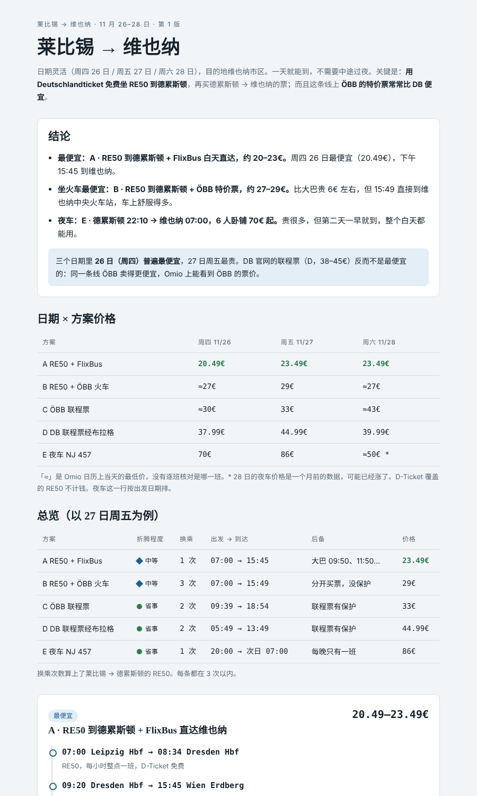
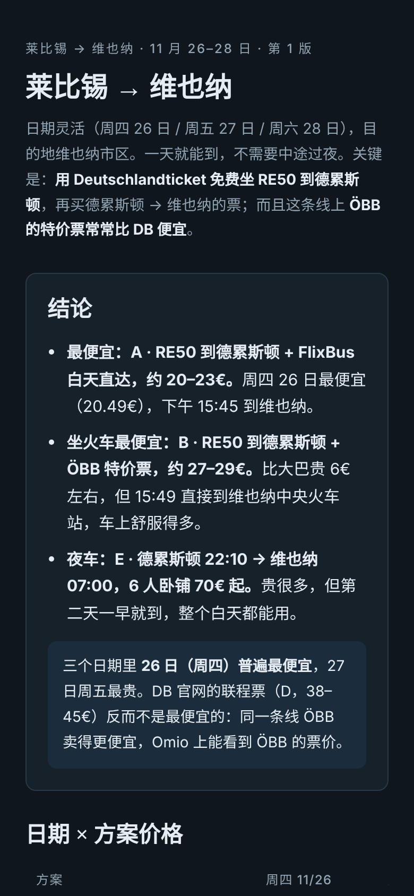

# Europe Route Finder · 欧洲交通路线查找 skill

**让 AI agent 像一个很会省钱的欧洲老司机那样帮你查路线**：不只搜「A → B」，而是把出发地和目的地都扩展成一圈枢纽城市，找比价网站搜不到的直达车、夜车和大区班车，对比官网和比价平台的真实价格，把中途青旅也算进总价，最后输出一张可以直接打开的对比页。

适用于 Claude、Claude Code、Cursor、Codex、ChatGPT、Gemini 等能上网的 AI agent。

<p>
  
  
</p>

示例：[`europe-route-finder/examples/leipzig-vienna.html`](europe-route-finder/examples/leipzig-vienna.html)（下载后用浏览器打开）

---

## 为什么需要它

Google 地图、Omio、Interrail 都只在「出发站 → 目的站」之间算路线，所以经常漏掉更好的方案：

- **莱比锡 → 法国滑雪场 Les Arcs**：直觉是「去日内瓦中转」，但日内瓦住宿贵、瑞士火车贵、日内瓦到雪场的接驳也贵。更好的做法是第一天坐 DB 到伯尔尼（约 41€，住一晚青旅约 33€），第二天坐 FlixBus **越过日内瓦**到安纳西，换大区班车 Y51 到阿尔贝维尔，再坐 TER 到山下，凭火车票免费坐缆车上山。全程约 105–110€，中午就到，每一段都有后备班次。
- **莱比锡 → 维也纳**：用 Deutschlandticket 免费坐区域车到德累斯顿，再坐 FlixBus 白天直达，约 20€；坐火车的话，同一班车 ÖBB 卖 29€，bahn.de 加 BahnCard 25 却要 49.99€。
- **莱比锡 → 布达佩斯**：德累斯顿有直达布达佩斯的夜车，很多平台搜不到。

这个 skill 把这些经验写成了固定的流程，让 agent 每次都按这个思路查。

## 它会做什么

1. **两端扩展成枢纽集合**：找到目的地的「最后一个火车站」和它所在的铁路线，列出能接上这条线的城市（包括只通大区班车的城市），再往外找住宿便宜的过夜枢纽。
2. **拼路线**：一天直达、两段式（第一天长途到便宜的过夜城市，第二天短途）、卧铺夜车、飞机基准；每条路线都用 Google 地图公交模式交叉核对。
3. **查真实价格**：DB、SBB、SNCF、ÖBB、FlixBus、RegioJet、Nightjet 等官网和 Omio 比价，按日期范围查，白天车按二等座、夜车按卧铺。
4. **查青旅**：Hostelworld 和 Booking 按具体日期、具体房型逐家查。
5. **算总价、排序**：含住宿和最后一段，考虑换乘次数和后备班次。
6. **输出对比页**：agent 只写一份 JSON，由固定模板渲染成页面，省 token，页面每次都一样整齐。

## 项目结构

```
europe-route-finder/          ← skill 本体（可以整个文件夹打包上传到 Claude）
├── SKILL.md                  ← 完整流程：第 0–7 步
├── profile.md                ← 你的个人设置（出发地、车票、偏好），先改这个
├── schema/trip.schema.json   ← 行程 JSON 的格式
├── template/                 ← 固定页面模板
│   ├── shell.html
│   ├── style.css             ← 浅色/深色主题、手机适配
│   └── render.js             ← 在浏览器里把 JSON 渲染成对比页
├── scripts/
│   ├── render.mjs            ← JSON → 独立 HTML（Node 18+，无依赖）
│   └── render.py             ← 同上（Python 3，只用标准库）
└── examples/
    ├── leipzig-vienna.json
    └── leipzig-vienna.html

AGENTS.md                     ← Cursor / Codex / Gemini CLI 等会自动读的入口
CLAUDE.md                     ← Claude Code 的入口（引用 AGENTS.md）
GEMINI.md                     ← Gemini CLI 的入口
.cursor/rules/                ← Cursor 规则
.claude/skills/               ← Claude Code 项目 skill（链接到 europe-route-finder/）
```

## 先改个人设置

打开 [`europe-route-finder/profile.md`](europe-route-finder/profile.md)，换成你自己的情况。现在里面是作者的设置：

- 住在莱比锡，有 Deutschlandticket 和 BahnCard 25
- 不坐过夜大巴
- 中途住青旅，女生间优先
- 每一段（两个大城市之间）换乘不超过 3 次

agent 每次查路线前都会先读这个文件。

## 怎么用

### Claude（claude.ai / 桌面端）

1. 下载仓库，把 `europe-route-finder/` 文件夹打成 zip（或运行 `npm run package`）。
2. 在 Claude 的 **设置 → Skills（技能）** 里上传这个 zip。
3. 对 Claude 说：「莱比锡到维也纳，11 月 27 日左右，帮我查一下」。Claude 会按流程查完，渲染页面并发布成 Artifact。

### Claude Code

```bash
git clone https://github.com/JialiNong/europe-route-finder-skill
cd europe-route-finder-skill
claude
```

仓库里的 `.claude/skills/europe-route-finder` 会被识别为项目 skill，直接说「莱比锡到维也纳 11.27」或输入 `/europe-route-finder`。想在所有项目里都能用，把 `europe-route-finder/` 复制到 `~/.claude/skills/`。

### Cursor / Codex / Gemini CLI

用这个仓库打开项目即可：它们会自动读 `AGENTS.md`（Cursor 还会读 `.cursor/rules/`，Gemini CLI 读 `GEMINI.md`）。在对话里说出发地、目的地和日期，agent 会把结果存到 `trips/<行程名>.json` 和 `.html`。

这些 agent 需要能上网（网页搜索或浏览器工具），否则查不到实时价格。

### ChatGPT / Gemini（网页版）

1. 把 `europe-route-finder/SKILL.md`、`profile.md`、`schema/trip.schema.json`、`examples/leipzig-vienna.json` 上传到对话（或放进 GPT / Gem 的知识库，把 SKILL.md 的内容作为说明）。
2. 打开联网搜索。
3. 让它查完后按 schema 输出 JSON。
4. 有代码解释器时，再上传 `scripts/render.py` 和 `template/` 里的三个文件，让它运行 `python3 render.py trip.json` 生成 HTML 给你下载；没有的话把 JSON 存下来，在本地渲染：

```bash
node europe-route-finder/scripts/render.mjs trip.json
# 或
python3 europe-route-finder/scripts/render.py trip.json
```

## 页面模板

页面的样式固定在 `template/` 里，agent 只输出数据：

- 方案编号按 `routes` 的顺序自动生成 A、B、C…
- 「日期 × 方案价格」表和「总览」表从 routes 自动生成，每列最低价自动标绿
- 浅色/深色主题跟随系统，手机上表格可以左右滑动
- 生成的 HTML 是单个文件，样式和脚本都内联，可以直接发给别人

想改样式时改 `template/style.css` 或 `template/render.js`，然后运行 `npm run example` 用示例数据检查一遍。

## 注意

- 价格是查询时的快照，以官网为准。
- agent 不会替你下单，也不会填写任何个人或支付信息。
- `trips/` 默认不提交到 git，里面可能有你的行程和个人信息。

## License

MIT
